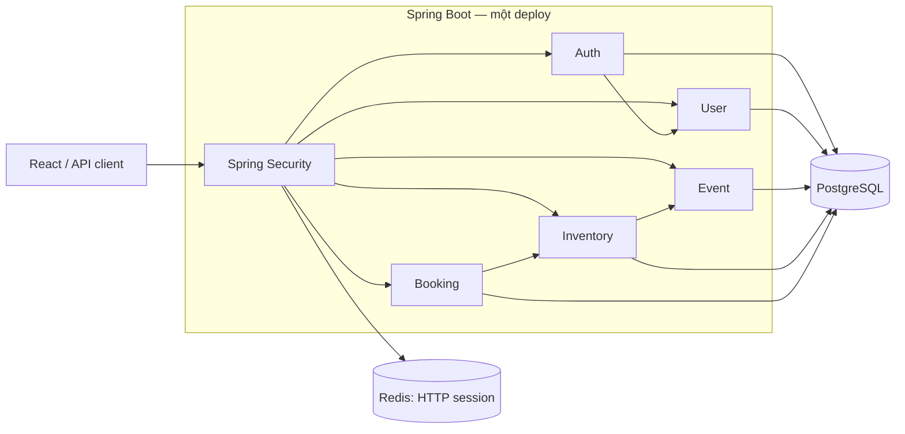

# ADR 0001 — Modular monolith và ranh giới dữ liệu

**Trạng thái:** Đã chấp nhận cho M1 sau tự review ADV-001 · **Phạm vi:** milestone M1 (Sprint 1–4)

## Bối cảnh

TicketLock hiện là một ứng dụng Spring Boot. PostgreSQL lưu tài khoản và refresh token; Redis lưu HTTP session. React dùng session tại `/login`; JWT API dành cho client mobile và chỉ bật với profile `jwt`. Event, Inventory và Booking chưa được triển khai. M1 cần kiểm chứng tính đúng đắn khi nhiều người tranh ghế trước khi thêm hàng đợi hay tách service.

## Kiểm kê code hiện tại của ADV-001

| Thành phần | Hiện có trong repository |
|---|---|
| `auth` | JSON session login/đăng ký/CSRF; JWT login, refresh rotation và logout khi bật `jwt` |
| `user` | `User`, `Role`, repository, DTO/mapper, service và API hồ sơ `/api/users/me`, `/api/users/{userId}` |
| `security` | SecurityFilterChain, user details, method security và Redis session registry |
| Controller lab | `/hello`, `/public/hello`, `/me`, `/blocked`, `/lab/session`, `/lab/session/status`, role/method-security lab |
| PostgreSQL theo entity | `app_users`, `refresh_tokens`; schema thực tế và các bảng phụ/migration lịch sử cần kiểm kê riêng ở ADV-002 |
| Redis | HTTP session và index principal; không chứa booking/reservation |
| Frontend | React dùng session; app mobile chưa có, JWT API dùng profile `jwt` |

`SecurityConfig` ở package gốc. Sau refactor, `AccessTokenService`, `RegistrationService` và `CustomUserDetailsService` gọi interface nội bộ `UserAccounts`; implementation thuộc User truy cập `UserRepository`. `RefreshToken` lưu UUID `userId` thay cho liên kết JPA đến entity User. `UserSecurity` truy cập repository để kiểm tra ownership User, không tự nó là vi phạm giữa hai module.

## Quyết định

M1 dùng một ứng dụng, một lần deploy và một PostgreSQL. Tổ chức code theo module nghiệp vụ; mỗi module sở hữu dữ liệu và công bố service/interface cho module khác. Controller gọi service của module mình; không gọi repository của module khác. Không tạo dependency vòng giữa các module. Package cụ thể được tạo khi triển khai nghiệp vụ, không tạo package rỗng để minh họa.

Mũi tên giữa module thể hiện lời gọi qua interface được công bố, không cho phép truy cập repository/bảng trực tiếp. Payment và Ticket là ranh giới dự kiến cho giai đoạn sau, chưa có trong M1. Kafka, service tách riêng và engine single-writer cũng chưa tồn tại trong hiện trạng.

## Quyền sở hữu

| Module | Dữ liệu và trách nhiệm | Interface dự kiến |
|---|---|---|
| User | User, email, role, trạng thái, hồ sơ và password hash | Interface tra cứu danh tính và thông tin xác thực cần thiết cho Auth; không trả hash qua HTTP |
| Auth | Xác thực, session, access/refresh token và vòng đời refresh family | Login, refresh, logout; gọi interface User để lấy thông tin tài khoản |
| Event | Event, Show, layout Seat; quản lý publish | Kiểm tra show có thể đặt và lấy danh sách ghế trong layout |
| Inventory | ShowSeat, trạng thái ghế theo show, reservation, deadline, version | Hold, đọc, release, confirm reservation |
| Booking | Booking và liên kết reservation | Tạo, đọc booking theo owner; gọi Inventory qua interface |
| Payment (sau M1) | Payment operation và kết quả thanh toán | Charge, query, refund |
| Ticket (sau M1) | Vé và check-in | Phát vé, tra cứu, check-in |

Event mô tả sự kiện; Show là một suất diễn cụ thể. Seat thuộc layout của Event; ShowSeat là trạng thái của một ghế trong một Show. Một layout có thể phục vụ nhiều show mà trạng thái ghế độc lập. Với M1, một khi Show đã mở bán thì sơ đồ ghế của suất đó bị khóa: không thêm, xóa, đổi định danh hay bố trí ghế. Nếu layout được chia sẻ, thay đổi layout không được làm thay đổi các Show đã mở bán; cần snapshot/version hoặc cơ chế tương đương. Ngừng bán không tự mở khóa lại; thay đổi sau đó cần quy trình riêng xử lý hold/vé và chưa thuộc M1. Giá từng ghế và loại tiền được server chốt và lưu snapshot cùng transaction giữ ghế thành công. Trong thời gian hold hợp lệ, checkout dùng snapshot đó, kể cả khi giá niêm yết thay đổi; hold hết hạn hoặc bị hủy không giữ giá cho lần đặt mới. Giá hiển thị trước hold có thể đã thay đổi; quy trình thông báo/xác nhận giá thực tế trước thanh toán sẽ được thiết kế tại ADV-003.

## Trust boundary

- Request body, UUID, role, giá và owner do client gửi đều là đầu vào chưa tin cậy. Server lấy principal từ `Authentication` đã xác thực; quyền và ownership được kiểm tra phía server.
- Session chain sử dụng session cookie và CSRF cho các thao tác thay đổi. Với profile `jwt`, `/api/token/**` và `/api/stateless/**` dùng chain stateless riêng; không mặc định mọi `/api/**` nhận bearer JWT.
- Session principal và JWT `sub` dùng UUID user sau khi xác thực; email vẫn dùng để đăng nhập và được đọc từ User khi hiển thị. Session cũ chứa principal email cần đăng nhập lại sau deploy; trước cutover cần kế hoạch chấm dứt hoặc chuyển đổi các phiên cũ để tránh bỏ sót giới hạn concurrent session.
- Redis lưu session, không sở hữu reservation. Logout hoặc hết session không tự hủy hold hay booking.

## Transaction và invariant M1

- PostgreSQL là nguồn sự thật cho trạng thái ghế. Một show-seat có tối đa một hold hợp lệ tại một thời điểm.
- Hold nhiều ghế thành công toàn bộ hoặc không ghế nào. Lock/conditional update và thay đổi reservation nằm trong transaction DB; phản hồi thành công chỉ sau commit.
- Hold hợp lệ khi `now < deadline` theo đồng hồ server. Confirm, release và expire kiểm tra reservation, version và trạng thái phù hợp; confirm sau deadline bị từ chối ngay cả khi worker chưa dọn. Lệnh cũ không được giải phóng hold mới.
- M1 có thể dùng local transaction trên cùng DB; interface module không có nghĩa transaction tự động bao trùm các service/DB sau khi tách. Khi tách phải thiết kế protocol nhất quán riêng.

Ví dụ: customer gửi danh sách seat ID để hold. Security xác thực principal; application service chuyển danh tính đã xác thực sang user ID nội bộ đáng tin cậy. Inventory nhận user ID từ service nội bộ, kiểm tra show, ghế và điều kiện hold, rồi khóa hoặc cập nhật các ghế trong transaction. Nếu một ghế không hợp lệ hoặc đã bị giữ, transaction rollback toàn bộ. Server chỉ trả thành công sau commit. Release/confirm kiểm tra owner theo policy và reservation/version/deadline tại server.

## Phương án cân nhắc và hệ quả

- **Tách microservice ngay:** độc lập deploy nhưng thêm network, message và consistency trước khi có baseline đúng. Chưa chọn cho M1.
- **Một monolith không có ownership:** dễ bắt đầu nhưng dễ hình thành truy cập bảng chéo và dependency vòng. Không chọn.
- **Modular monolith:** đơn giản hóa transaction và kiểm thử; cần review dependency và ownership vì cùng process/DB không tự ngăn truy cập chéo.

## Review và việc cần theo dõi

- Client đổi role trong body không thay quyền: quyền đến từ principal đã xác thực.
- Hai request tranh cùng ghế không được cùng tạo hold hợp lệ; phải kiểm thử trên PostgreSQL thật ở ADV-012.
- Một ghế lỗi trong nhóm phải rollback cả nhóm; kiểm thử ở ADV-009/ADV-012.
- Principal UUID, khóa layout và chốt giá khi hold đã được chọn; chi tiết xác nhận giá, phụ phí và schema cần hoàn thiện trong ticket API/booking. ADR này là quyết định thiết kế, chưa phải bằng chứng các invariant đã được triển khai.

## Ba tình huống review thiết kế

| Tình huống | Quyết định cần được thực thi ở ticket sau | Bằng chứng dự kiến |
|---|---|---|
| Client gửi role ADMIN/ownerId của người khác | Bỏ qua vai trò, owner do client tự khai; dùng Authentication và kiểm tra quyền/ownership phía server. | ADV-003 định nghĩa contract; ADV-012 kiểm thử quyền. |
| Hai request giữ cùng một ghế | DB là nguồn sự thật; transaction khóa/cập nhật có điều kiện để chỉ một hold hợp lệ thắng. | ADV-009 và ADV-012 kiểm thử đồng thời trên PostgreSQL. |
| Một ghế trong nhóm đã bị giữ | Rollback cả transaction; không lưu hold thành công một phần. | ADV-009 và ADV-012 kiểm tra trạng thái toàn bộ nhóm. |

Đây là review thiết kế, chưa chứng minh bằng test nghiệp vụ vì các module giữ ghế chưa tồn tại. Chi tiết xác nhận khi giá thay đổi trước hold và chính sách phí vẫn cần được mô tả trong ADV-003 trước implementation.

## Ranh giới Auth–User hiện tại

User công bố interface `UserAccounts`; Auth gọi interface này thay vì truy cập repository User trực tiếp. Interface nội bộ hiện trả `Account` có password hash cho cả tra cứu theo email và ID; hash chỉ dùng nội bộ, không trả qua HTTP hay log. Đây là phạm vi dữ liệu rộng hơn mức tối thiểu: cân nhắc tách kiểu trả về xác thực và hồ sơ khi thay đổi interface sau này. Registration cần một use case tạo user do User sở hữu, với phân định rõ transaction và xử lý email trùng. `RefreshToken` lưu `userId` trên cột `user_id` hiện có. Foreign key hiện có trong database cũ không bị xóa bởi refactor này; schema tạo mới dùng migration V1 của ADV-002 để quy định foreign key, vì mapping UUID không tự tạo foreign key như quan hệ JPA trước đây. Việc tách module không yêu cầu tách service/deploy trong M1.

### Kết quả tự review ADV-001 — 24/11/2026

- Bảng ownership chọn duy nhất Event cho layout và Inventory cho ShowSeat/hold; Booking không ghi trực tiếp trạng thái Inventory. Sơ đồ mô tả dependency dự kiến, không khẳng định module mới đã tồn tại.
- Ba tình huống role/owner giả, tranh một ghế và lỗi một ghế trong nhóm đã được rà soát theo bảng trên. Những kết luận về hold là yêu cầu thiết kế; ADV-009 và ADV-012 vẫn phải chứng minh bằng kiểm thử.
- Session dùng principal UUID trong `CustomUserDetailsService`; JWT `sub` dùng UUID; các phiên cũ dùng email cần cutover. API và chính sách xác nhận giá, phí còn là việc cụ thể của ADV-003, không chặn quyết định ranh giới module.
- Đây là tự review tài liệu theo tiêu chí ticket, không thay thế review PR độc lập nếu dự án yêu cầu.
